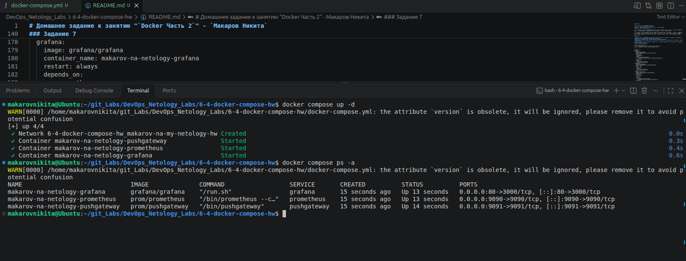
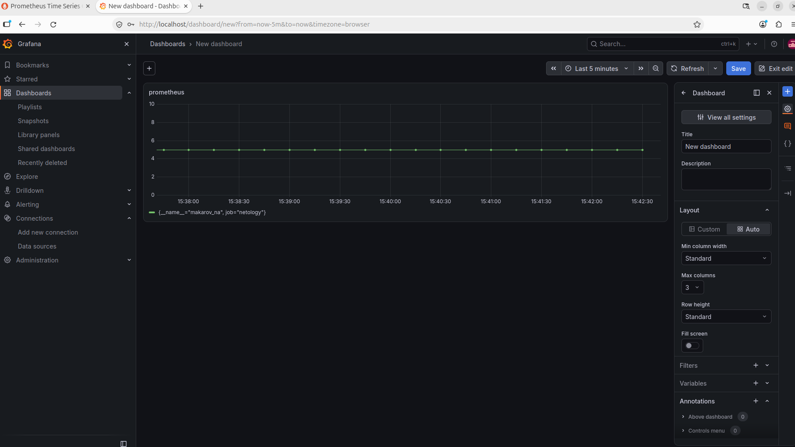
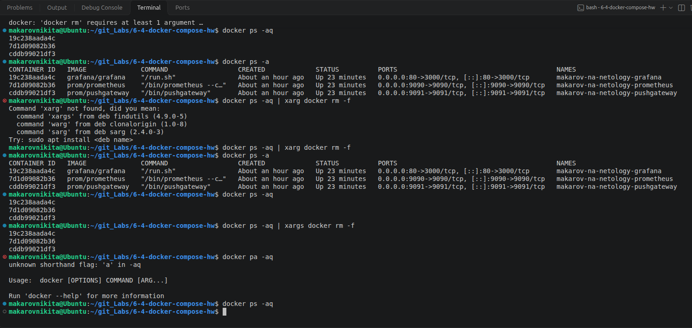

# Домашнее задание к занятию "`Docker Часть 2`" - `Макаров Никита`

### Задание 1

`Установите Docker Compose и опишите, для чего он нужен и как может улучшить лично вашу жизнь.`

Я установил актуальную версию на данный момент **Docker Compose** version v5.8.0. В отличии от обычного Dockera  нам не придется в ручную поднимать каждый контейнер. Нам открывается возможность собрать собвенный конфиг (yml) благодаря которому мы одной командой можем поднять сразу все контейнеры с выстроенной структурой. Так же легко переносить все между серверами без опасения каких либо изменений в работе.

---

### Задание 2

`Создайте файл docker-compose.yml и внесите туда первичные настройки:`

version;
services;
volumes;
networks.
При выполнении задания используйте подсеть 10.5.0.0/16. Ваша подсеть должна называться: <ваши фамилия и инициалы>-my-netology-hw. Все приложения из последующих заданий должны находиться в этой конфигурации.

```version: '3'
services:
volumes:
networks:
  makarov-na-my-netology-hw:
    driver: bridge
    ipam:
      config:
        - subnet: 10.5.0.0/16
```
---

### Задание 3

`1.Создайте конфигурацию docker-compose для Prometheus с именем контейнера <ваши фамилия и инициалы>-netology-prometheus.`
`2.Добавьте необходимые тома с данными и конфигурацией (конфигурация лежит в репозитории в директории 6-04/prometheus ).`
`3.Обеспечьте внешний доступ к порту 9090 c докер-сервера.`

1. В `docker-compose.yml` добавлен сервис Prometheus с именем контейнера `makarov-na-netology-prometheus` и подключением к сети `makarov-na-my-netology-hw`.
2. К сервису Prometheus подключены два тома: локальный файл конфигурации ./prometheus/prometheus.yml (в /etc/prometheus/prometheus.yml) и именованный том prometheus-data (в /prometheus) для сохранения собранных данных; том prometheus-data объявлен в корневом разделе volumes
3. `Настроен проброс порта 9090:9090, контейнер запущен командой docker compose up -d, проверена его работа через docker ps и доступность веб-интерфейса Prometheus по порту 9090.

```
version: '3'
services:
  prometheus:
    image: prom/prometheus
    container_name: makarov-na-netology-prometheus
    restart: always
    volumes:
      - ./prometheus/prometheus.yml:/etc/prometheus/prometheus.yml
      - - prometheus-data:/prometheus
    ports:
      - 9090:9090
    networks:
      makarov-na-my-netology-hw:
        ipv4_address: 10.5.0.10
volumes:
  prometheus-data:
    driver: local
networks:
  makarov-na-my-netology-hw:
    driver: bridge
    ipam:
      config:
        - subnet: 10.5.0.0/16
```


### Задание 4

`1.Создайте конфигурацию docker-compose для Pushgateway с именем контейнера <ваши фамилия и инициалы>-netology-pushgateway.`
`2.Обеспечьте внешний доступ к порту 9091 c докер-сервера.`

1. Добавил в docker-compose.yml сервис pushgateway на базе образа prom/pushgateway, задал имя контейнера makarov-na-netology-pushgateway, политику перезапуска restart: always и подключил его к общей сети makarov-na-my-netology-hw с IP 10.5.0.11.
2. Настроил проброс порта 9091:9091 в блоке ports для внешнего доступа с докер-сервера, запустил сервис командой docker compose up -d и проверил доступность интерфейса по адресу http://localhost:9091 (а также статус UP в Prometheus).


```
pushgateway:
    image: prom/pushgateway
    container_name: makarov-na-netology-pushgateway
    restart: always
    ports:
      - 9091:9091
    networks:
      makarov-na-my-netology-hw:
        ipv4_address: 10.5.0.11
```

`При необходимости прикрепитe сюда скриншоты
`

### Задание 5

`1.Создайте конфигурацию docker-compose для Grafana с именем контейнера <ваши фамилия и инициалы>-netology-grafana.`
`2.Добавьте необходимые тома с данными и конфигурацией (конфигурация лежит в репозитории в директории 6-04/grafana.`
`3.Добавьте переменную окружения с путем до файла с кастомными настройками (должен быть в томе), в самом файле пропишите логин=<ваши фамилия и инициалы>` `пароль=netology.`
`4.Обеспечьте внешний доступ к порту 3000 c порта 80 докер-сервера.`

1. Добавил в docker-compose.yml сервис grafana на базе образа grafana/grafana, задал имя контейнера makarov-na-netology-grafana и подключил его к общей сети makarov-na-my-netology-hw (IP 10.5.0.12), чтобы Grafana видела Prometheus.
2. Подключил два тома в блоке volumes: именованный том grafana-data:/var/lib/grafana (чтобы при перезапуске контейнера не пропадали дашборды и настройки) и проброс файла конфигурации ./grafana/custom.ini:/etc/grafana/custom.ini с хоста внутрь контейнера.
3. В файле grafana/custom.ini в секции [security] прописал логин admin_user = makarov-na и пароль admin_password = netology, а в секции environment указал переменную GF_PATHS_CONFIG=/etc/grafana/custom.ini, чтобы Grafana при запуске применила этот конфиг. (Учётные данные оставлены в файле в рамках учебного стенда; в реальных проектах они выносятся из репозитория в .env под .gitignore или передаются через Docker Secrets.)
4. Настроил проброс портов 80:3000, запустил стек командой docker compose up -d и проверил в браузере, что Grafana открывается по адресу http://localhost (порт 80) и пускает с заданными логином и паролем.

```
grafana:
    image: grafana/grafana
    container_name: makarov-na-netology-grafana
    restart: always
    ports:
      - 80:3000
    volumes:
      - grafana-data:/var/lib/grafana
      - ./prometheus/custom.ini:/etc/grafana/grafana.ini
    environment:
      - GF_PATHS_CONFIG=/etc/grafana/grafana.ini
    networks:
      makarov-na-my-netology-hw:
        ipv4_address: 10.5.0.12
volumes:
  prometheus-data:
    driver: local
  grafana-data:
    driver: local
```

### Задание 6

`1.Настройте поочередность запуска контейнеров.`
`2.Настройте режимы перезапуска для контейнеров`
`3.Настройте использование контейнерами одной сети.`
`4.Запустите сценарий в detached режиме`

1. В этом задании я добавил в docker-compose.yml поочерёдность запуска контейнеров с помощью параметра depends_on, чтобы сервисы поднимались не все сразу, а по цепочке: сначала запускается pushgateway, за ним prometheus, и в самом конце — grafana.

2. Что касается режимов перезапуска (restart: always) и объединения всех трёх контейнеров в одну сеть makarov-na-my-netology-hw, то эти настройки я прописал ещё на прошлых этапах, когда собирал конфиг с помощью YAML-расширения в VS Code. После добавления зависимости запуска я перезапустил весь стек в фоновом (detached) режиме командой docker compose up -d — контейнеры поднялись в нужном порядке и работают в фоне, не занимая терминал.

### Задание 7

`1.Выполните запрос в Pushgateway для помещения метрики <ваши фамилия и инициалы> со значением 5 в Prometheus: echo "<ваши фамилия и инициалы> 5" | curl --data-binary @- http://localhost:9091/metrics/job/netology.`
`2.Залогиньтесь в Grafana с помощью логина и пароля из предыдущего задания`
`3.Cоздайте Data Source Prometheus (Home -> Connections -> Data sources -> Add data source -> Prometheus -> указать "Prometheus server URL = http://prometheus:9090" -> Save & Test).`
`4.Создайте график на основе добавленной в пункте 5 метрики (Build a dashboard -> Add visualization -> Prometheus -> Select metric -> Metric explorer -> <ваши фамилия и инициалы -> Apply.`
`5.В качестве решения приложите:`

-docker-compose.yml целиком;
-скриншот команды docker ps после запуске docker-compose.yml;
-скриншот графика, построенного на основе вашей метрики.

1.
```version: '3'
services:
  prometheus:
    image: prom/prometheus
    container_name: makarov-na-netology-prometheus
    restart: always
    depends_on:
      - pushgateway
    volumes:
      - prometheus-data:/prometheus
      - ./prometheus/prometheus.yml:/etc/prometheus/prometheus.yml
    ports:
      - 9090:9090
    networks:
      makarov-na-my-netology-hw:
        ipv4_address: 10.5.0.10
  pushgateway:
    image: prom/pushgateway
    container_name: makarov-na-netology-pushgateway
    restart: always
    ports:
      - 9091:9091
    networks:
      makarov-na-my-netology-hw:
        ipv4_address: 10.5.0.11
  grafana:
    image: grafana/grafana
    container_name: makarov-na-netology-grafana
    restart: always
    depends_on:
      - prometheus
    ports:
      - 80:3000
    volumes:
      - grafana-data:/var/lib/grafana
      - ./prometheus/custom.ini:/etc/grafana/grafana.ini
    environment:
      - GF_PATHS_CONFIG=/etc/grafana/grafana.ini
    networks:
      makarov-na-my-netology-hw:
        ipv4_address: 10.5.0.12
volumes:
  prometheus-data:
    driver: local
  grafana-data:
    driver: local
networks:
  makarov-na-my-netology-hw:
    driver: bridge
    ipam:
      config:
        - subnet: 10.5.0.0/16
```
2. 
3. 

### Задание 8

`1.Остановите и удалите все контейнеры одной командой.`
`В качестве решения приложите скриншот консоли с проделанными действиями.`

1. 

### Дополнительные задания*

### Задание 9*

`1. Создайте конфигурацию docker-compose для Alertmanager с именем контейнера <ваши фамилия и инициалы>-netology-alertmanager.`
`2. Добавьте необходимые тома с данными и конфигурацией, сеть, режим и очередность запуска.`
`3. Обновите конфигурацию Prometheus (необходимые изменения ищите в презентации или документации) и перезапустите его.`
`4. Обеспечьте внешний доступ к порту 9093 c докер-сервера.`
`5. В качестве решения приложите скриншот с событием из Alertmanager.`

1. Конфигурация сервиса в docker-compose.yml:
В файл docker-compose.yml добавлен сервис alertmanager на базе образа prom/alertmanager с именем контейнера makarov-na-netology-alertmanager
2. Подключены том для хранения данных (alertmanager_data) и файл настроек alertmanager.yml, сервис добавлен в общую сеть с Prometheus.
3. В prometheus.yml в разделе alerting указан адрес alertmanager:9093, после чего контейнер Prometheus перезапущен для применения настроек.
4. Проброшен порт 9093:9093 для доступа к веб-интерфейсу Alertmanager снаружи.
5. 

## Задание 10*

`1. Запустите свой сценарий на чистом железе без предзагруженных образов.`
`2. Опишите выполненный вами процесс развертывания сценария.`
`3. Как вы думаете зачем может понадобиться такой способ развертывания?`

2. Подготовлено чистое окружение без предварительно загруженных Docker-образов и томов, установлены Docker и Docker Compose. Из Git-репозитория склонирован проект с конфигурационными файлами (docker-compose.yml, prometheus.yml, alertmanager.yml). С помощью команды docker compose up -d выполнено автоматическое скачивание актуальных образов (prometheus, alertmanager, pushgateway, grafana), создание изолированной сети и томов для хранения данных, а также запуск всех сервисов с учётом зависимостей (depends_on). После старта контейнеров проверена доступность веб-интерфейсов.
3. Такой способ развертывания нужен для того, чтобы убедиться, что проект действительно запускается «с нуля» только из сохранённых в Git файлов и не держится на старом кэше или забытых ручных правках. В реальной работе это спасает при поломке оборудования: если старый сервер выйдет из строя, всю систему мониторинга можно за пару минут восстановить на новом железе одной командой, а также легко переносить и разворачивать её на любых других или тестовых машинах без повторной ручной настройки.